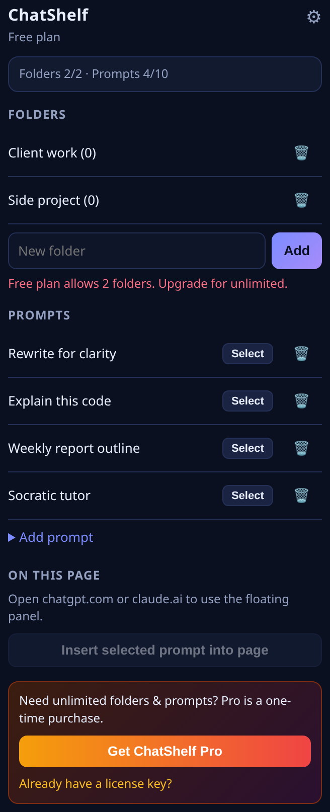
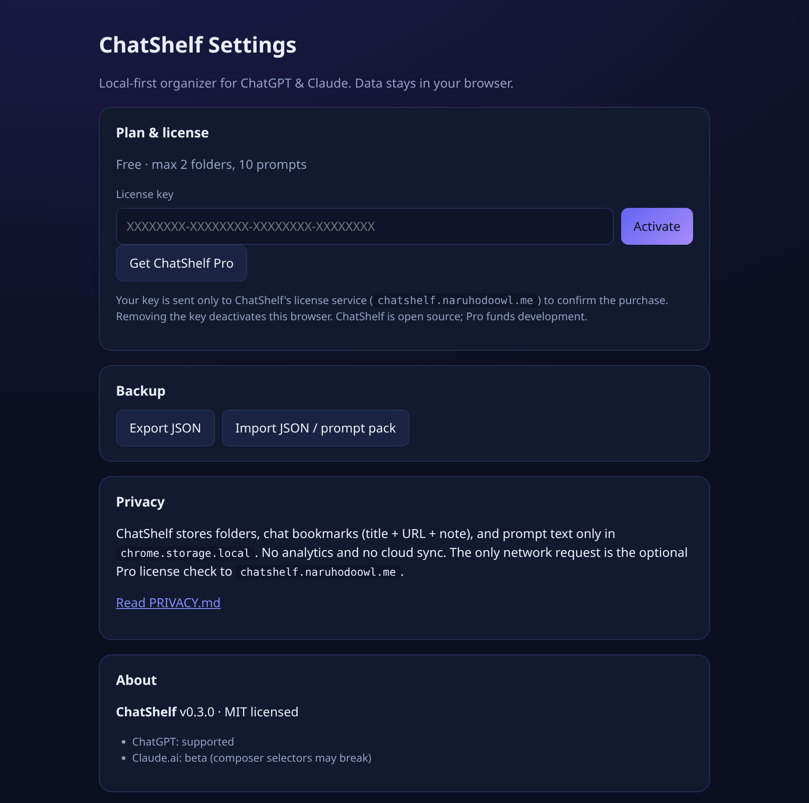

<p align="center">
  
</p>

<h1 align="center">ChatShelf</h1>
<p align="center"><b>Folders and a prompt library for ChatGPT &amp; Claude, right inside the page.</b><br/>
Open source · local-first · no account · no tracking</p>

<p align="center">
  <a href="#install-in-60-seconds">Install</a> ·
  <a href="#features">Features</a> ·
  <a href="#chatshelf-pro">Pro</a> ·
  <a href="#privacy">Privacy</a> ·
  <a href="#contributing">Contributing</a>
</p>

---

Your ChatGPT sidebar has 400 chats called "New chat". You retype the same prompts every day. **ChatShelf** fixes both:

- 📁 **Save any conversation into a folder** (title, link, and a note) with one click from a floating button on the page.
- ⚡ **Keep a prompt library** and insert any prompt straight into the ChatGPT / Claude composer.
- 🔒 **Everything stays in your browser** (`chrome.storage.local`). No server, no login, no analytics.

<p align="center">
  
  &nbsp;&nbsp;
  
</p>

> 🎬 _Demo GIF coming soon: `docs/demo.gif` (save chat → folder → insert prompt)._

## Features

| | Free | Pro |
|---|:---:|:---:|
| Floating panel on `chatgpt.com` / `chat.openai.com` | ✅ | ✅ |
| Floating panel on `claude.ai` (beta) | ✅ | ✅ |
| Save current chat to a folder (title + URL + note) | ✅ | ✅ |
| Prompt library + one-click insert into the composer | ✅ | ✅ |
| Export / import JSON backups | ✅ | ✅ |
| Import prompt packs (e.g. [`prompts/free-sample-20.chatshelf.json`](prompts/free-sample-20.chatshelf.json)) | up to limit | ✅ |
| Folders | 2 | **Unlimited** |
| Saved prompts | 10 | **Unlimited** |

## Install in 60 seconds

ChatShelf is plain HTML/CSS/JS (Manifest V3), so there is **no build step**.

1. Download this repo: **Code → Download ZIP** and unzip it (or `git clone`).
2. Open `chrome://extensions` in Chrome, Edge, Brave, or Arc.
3. Turn on **Developer mode** (top right).
4. Click **Load unpacked** and pick the folder that contains `manifest.json`.
5. Open [chatgpt.com](https://chatgpt.com) and click the purple 📁 button in the bottom-right corner.

To update: pull or download the new version, then click **Reload** on the extension card and refresh your ChatGPT tab.

### Try the free prompt sample

Settings (⚙ in the popup) → **Import JSON / prompt pack** → choose [`prompts/free-sample-20.chatshelf.json`](prompts/free-sample-20.chatshelf.json). It adds hand-written prompts for writing, coding, learning, work, and more. (Free plan keeps the first 10.)

## ChatShelf Pro

ChatShelf is free and MIT-licensed. If it saves you time, **Pro** removes the limits and funds development:

- Unlimited folders and prompts
- One-time purchase ($7), use it in up to 3 browsers
- 👉 **[Get ChatShelf Pro on Creem](https://www.creem.io/product/prod_3FqFPPZL4T22ud6OFOyhgg)**

After buying, open **Settings → License key**, paste the key from your Creem receipt, and click **Activate**. The first successful activation registers this browser. Later checks reuse that activation.

A separate paid prompt pack is not linked from this build. Import the free sample instead: [`prompts/free-sample-20.chatshelf.json`](prompts/free-sample-20.chatshelf.json).

> **Yes, you could edit the code and remove the limit.** It's open source, and that's fine for personal tinkering. Buying Pro is how you say thanks and keep the updates coming when ChatGPT changes its page again.

## Privacy

- Data is stored only in `chrome.storage.local` on your device.
- The extension reads the current page's title and URL **only when you click Save**. It never copies your chat messages.
- The only network request ChatShelf makes is the optional Pro license check to `https://chatshelf.naruhodoowl.me`, which sends your license key and a random install id. The Creem API key stays on that server.
- Full policy: [PRIVACY.md](PRIVACY.md)

### Permissions explained

| Permission | Why |
|---|---|
| `storage` | Save folders, bookmarks, and prompts locally |
| `activeTab` | Read the current tab's title/URL when you click Save |
| `chatgpt.com`, `chat.openai.com`, `claude.ai` | Show the floating panel and insert prompts |
| `chatshelf.naruhodoowl.me` | Activate or re-check a Pro license key |

## How it works

```
manifest.json
src/
├── background/service-worker.js   # message router + Creem license proxy client
├── content/content.js             # floating panel UI
├── content/adapters/chatgpt.js    # site-specific selectors (title, composer)
├── content/adapters/claude.js
├── popup/                         # toolbar popup
├── options/                       # settings, license, backup/import
└── shared/
    ├── constants.js               # free limits, Creem product config, storage keys
    └── storage.js                 # CRUD, limit gates, prompt-pack import
prompts/free-sample-20.chatshelf.json
server/license-proxy.py            # stdlib proxy: Creem API key stays here
```

Site-specific DOM code lives in `src/content/adapters/`. When ChatGPT or Claude changes its markup, that's usually the only file that needs a fix.

### Prompt pack format

```json
{
  "type": "prompt-pack",
  "version": 1,
  "name": "My pack",
  "prompts": [
    { "title": "Explain this code", "body": "Explain the code below...", "tags": ["coding"] }
  ]
}
```

Importing a pack **merges** prompts into your library (duplicates are skipped); it never touches your folders or saved chats.

### For forks / self-publishers

Checkout is the Creem product `prod_3FqFPPZL4T22ud6OFOyhgg` (`LICENSE` in `src/shared/constants.js`). The extension never calls `api.creem.io` and must not contain `CREEM_API_KEY`. It POSTs to `https://chatshelf.naruhodoowl.me/api/licenses/{activate,validate,deactivate}`.

Run `server/license-proxy.py` on the host behind that name and set `CREEM_API_KEY` only on the server. See [server/README.md](server/README.md). A key stays inactive until the first successful activation; the extension stores `instance_id` and weekly re-checks call validate. Offline errors keep Pro.

`LICENSE.PROMPT_PACK_URL` is intentionally empty. Do not point it at a store URL you do not control.

## Roadmap

- [ ] Demo GIF
- [ ] Search across saved chats and prompts
- [ ] Drag-and-drop chats between folders
- [ ] Prompt variables (fill `[BRACKETS]` before inserting)
- [ ] Gemini and Perplexity adapters
- [ ] Firefox build

Ideas and votes welcome in [Issues](../../issues).

## Contributing

Issues and PRs are welcome, especially adapter fixes when ChatGPT/Claude change their UI.

1. Fork, then load your fork unpacked (see above).
2. Keep it build-free: vanilla JS, no frameworks.
3. Put site-specific selectors in `src/content/adapters/`.
4. Run `node --check` on changed JS files before opening a PR.

## Disclaimer

ChatShelf is an independent project and is not affiliated with OpenAI or Anthropic. ChatGPT and Claude are trademarks of their respective owners.

## License

[MIT](LICENSE). Free for personal and commercial use.
